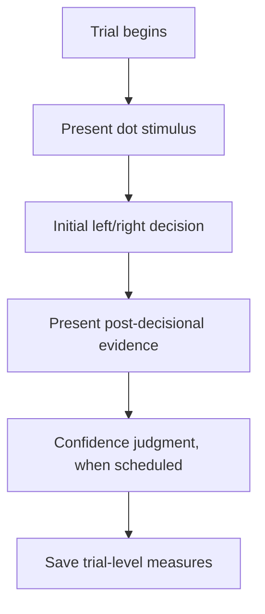

# Post-Decision Evidence and Confidence Experiment

A PsychoPy implementation of a perceptual decision-making experiment investigating how evidence presented **after an initial choice** affects confidence and subsequent choice behaviour.

This experiment was developed as part of a broader research project on perceptual decision-making. Its trial-level output is analysed in the companion [Sequential Decision Models](https://github.com/MahdiMoocavi/Sequential-Generalized-Linear-Model) repository.

## Research question

Does evidence presented after an initial left/right decision change participants' confidence in that decision, and how does this relate to sequential choice behaviour?

## Experimental procedure



The default configuration includes:

- 10 practice trials and 7 main blocks of 64 trials.
- Four difficulty levels, two target sides, and stronger/weaker post-decisional evidence conditions.
- Five additional dots presented after the initial response.
- A six-category confidence judgment in the final six main blocks.
- Confidence-label ordering counterbalanced by participant-ID parity.

Dot locations are sampled from bivariate normal distributions. The experiment records stimulus coordinates, decisions, response times, accuracy, confidence ratings, and post-decisional evidence conditions.

## Implementation

- **Language:** Python
- **Experiment framework:** PsychoPy
- **Additional dependencies:** NumPy, pywin32
- **Main script:** `beehive_experiment.py`

```bash
pip install psychopy numpy pywin32
python beehive_experiment.py
```

## Required study assets and environment

The script expects an `Instructions` directory containing `Slide1.JPG` through `Slide15.JPG`. These study-specific images are not distributed in this repository.

The implementation uses Windows-specific screen-resolution access and checks for an approximately 60 Hz display refresh rate. Review these assumptions before running the experiment on another operating system or monitor.

## Data and reproducibility

Trial-level data are saved through PsychoPy's `ExperimentHandler`. Timed-out trials are retained, with unavailable evidence summaries recorded as missing rather than silently omitted.

Participant data and instruction assets are not included. A full reproduction therefore requires the original study materials and an appropriate experimental setup.

## Related project

The companion [Sequential Decision Models](https://github.com/MahdiMoocavi/Sequential-Generalized-Linear-Model) repository analyses trial-level outputs from this experiment using mixed-effects models.
